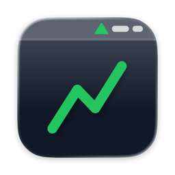
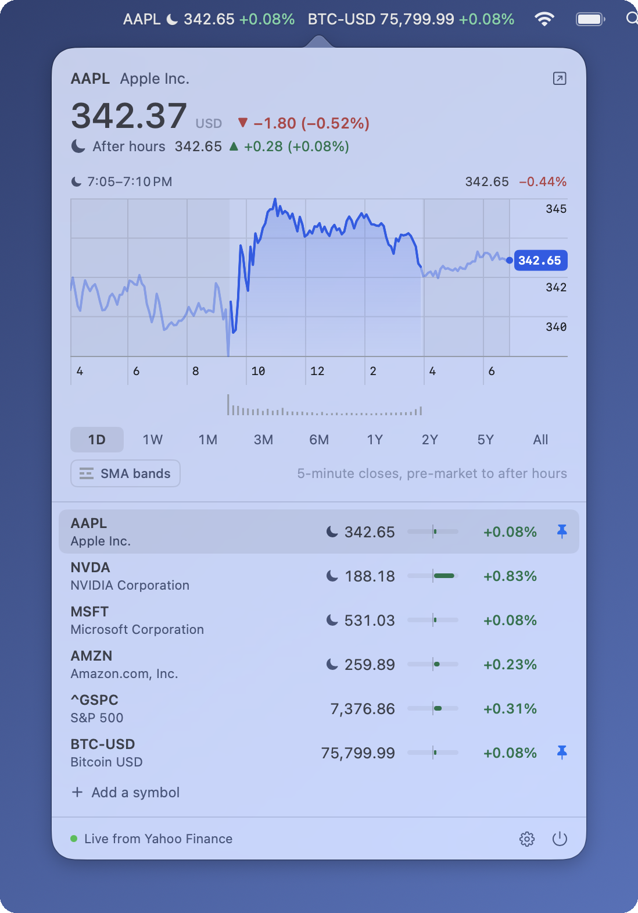

<p align="center"></p>

<h1 align="center">Portifo Bar</h1>

<p align="center">Live stock prices in the macOS menu bar.</p>

<p align="center">
  
</p>

Portifo Bar keeps the prices you follow in the menu bar: stocks, indexes,
crypto, currencies and futures, each with its move on the day, kept within
about half a minute of the market, after hours and overnight included. Click
it for a chart of any of them and the rest of your watchlist.

It reads the same Yahoo Finance data that powers
[Portifo](https://github.com/meysius/portifo). It's free, needs no account or
API key, and is a native Swift app with no dependencies.

## Install

Requires macOS 14 Sonoma or later, on Apple silicon or Intel. In Terminal:

```bash
curl -fsSL https://raw.githubusercontent.com/meysius/portifo-bar/main/install.sh | sh
```

This puts the latest release in `/Applications` and opens it. Run it again to
update.

The app isn't notarized by Apple, so macOS blocks it if it's downloaded in a
browser. The script downloads it with `curl` instead, which macOS doesn't
block, so you don't need to do anything else.

<details>
<summary>Installing by hand instead</summary>

Download `PortifoBar.zip` from the
[latest release](https://github.com/meysius/portifo-bar/releases/latest), unzip
it, and move **Portifo Bar** to Applications. macOS will refuse to open it,
saying it can't check it for malicious software. Remove the browser's
quarantine flag to fix this:

```bash
xattr -dr com.apple.quarantine "/Applications/Portifo Bar.app"
```

Or open it once, then go to System Settings → Privacy & Security and click
**Open Anyway**.
</details>

## Setup

1. **Find it in the menu bar.** It starts out showing Apple (`AAPL`), with the
   S&P 500 and Bitcoin in its watchlist.
2. **Add your symbols.** Click the price to open the popover, then click
   **Add a symbol** at the bottom of the list. Type a ticker (`AAPL`,
   `SHOP.TO`, `^GSPC`, `BTC-USD`, `EURUSD=X`) or a name (`shopify`). Remove a
   symbol by right-clicking its row.
3. **Choose what shows in the menu bar.** Click the pin on a row to show that
   symbol in the menu bar, or to take it out. Unpinned symbols stay in the
   watchlist.
4. **Start it with your Mac.** Open Settings (the gear in the popover's
   corner) and turn on **Launch at login**. If macOS asks, allow Portifo Bar
   in System Settings → General → Login Items. In Settings you can also show
   the move as a percentage, as an amount or not at all, and turn off the
   flash when a price moves.

If Portifo Bar disappears from the menu bar, it has run out of room: macOS
hides menu bar items that don't fit, for example beside the notch on a
MacBook. Pin fewer symbols, or show the price without its move.

To uninstall, click the power button in the popover's corner, delete
**Portifo Bar** from Applications, and run
`defaults delete app.portifo.bar` to remove its settings.

## What it does

- **Menu bar:** each pinned symbol's latest price and its move. Pre-market,
  after-hours and overnight prices are marked with a sunrise, a moon, or a moon
  and stars, and measured against the regular close, as Portifo does.
- **Click:** the symbol's price, large, with the day's move (an arrow as well
  as a colour), and its chart over 1D, 1W, 1M, 3M, 6M, 1Y, 2Y, 5Y or All,
  drawn as Portifo draws a holding's history: one line through each bar's
  close, fitted to the range's low and high on a four-band scale, nights and
  weekends left out, with volume beneath. The bars are those Portifo asks
  for: the day in 5 minutes, a week in 15, a month hourly, up to a year
  daily, 2 and 5 years weekly; all time monthly, where Portifo stops at
  10 years. The day runs from pre-market to after hours, those stretches
  shaded and the line faded through them, its latest price tagged on the
  scale; overnight (8 PM to 4 AM), when Yahoo's chart has no bars, it ends on
  the latest trade. The day is the last trading day, not the last 24 hours,
  and it turns over at the regular open: until 9:30 it is the day before,
  with today's pre-market after it, so a morning's look shows yesterday's
  move as Apple Stocks does, and the trading since. Crypto, currencies and
  futures, which never close for the night, show the last 24 hours, as
  Portifo does. Longer ranges keep to the regular session. Hover over the
  chart, or use ← →, to read any point's price and volume, and how far it
  stands from the previous close (or, over a longer range, the close before
  it began; for today's pre-market before the open, yesterday's close).
  Under the range, **SMA bands** draws the 200-day moving average inside
  bands 5, 10 and 15% either side of it, as Portifo does: the average dashed,
  the bands above it teal and below it orange, and of the bands only those
  the price crosses, which alone set the scale. The chip reads how far the
  price sits from the average; hovering lists every line on the crosshair.
  Below the chart is the watchlist, live: click a row to chart it, or its pin
  to show it in the menu bar (right-click for more). Each row's bar shows its
  move against the biggest mover's, so the day's movers stand out at a glance.
  The last row adds a symbol (`AAPL`, `SHOP.TO`, `^GSPC`, `BTC-USD`,
  `EURUSD=X`, or a name like `shopify`); Settings and Quit are in the corner.
- **Settings:** the watchlist, what shows beside the price in the menu bar,
  flashing on moves, and Launch at Login.

## Build from source

Requires macOS 14+ and Xcode 26 (Swift 6; its `actool` compiles the icon).

```bash
make run        # build "build/Portifo Bar.app" and launch it
make install    # copy it to /Applications (needed for Launch at Login)
make test       # unit tests
make zip        # build/PortifoBar.zip, as a release ships it
make tail SYMBOLS=AAPL,^GSPC,BTC-USD   # the live feed in the terminal, no UI
```

Run the app binary with `--open-settings` to open the settings window at
launch, for working on it.

## Releasing

Push a version tag:

```bash
git tag v0.2.0 && git push origin v0.2.0
```

[`release.yml`](.github/workflows/release.yml) then runs the tests, builds
the app for Apple silicon and Intel stamped with that version, and publishes
it as a GitHub release with `PortifoBar.zip` attached, which `install.sh`
picks up as the latest. The release notes list the changes since the
last tag.

## Where the prices come from

Prices are kept within about half a minute of the market. There are two
Yahoo feeds, and for each symbol whichever trade is newer wins:

| Feed | What it is | How often |
|---|---|---|
| `wss://streamer.finance.yahoo.com/?version=2` | The WebSocket finance.yahoo.com uses. Pushes every trade as base64 protobuf (`PricingData`), and is the only source of overnight trades. | As trades print. Sub-second on a good day; on Nov 5, 2026 it ran 20–50s behind, and some symbols (`^GSPC`) never stream. |
| `/v7/finance/spark` | Chart metadata for up to 20 symbols in one plain GET (no cookie or crumb). A second or two behind the trade, but only with a cache-buster: Yahoo's edge caches it for 5 minutes. | Every 30s per symbol while its market trades, and every 5 minutes otherwise: about 120 requests an hour. |

While the popover is open, the chart refetches once a minute for the day or
the week and every five minutes for longer ranges, with live prices moving
its last candle in between. The day's fetch, in 1-minute bars, also
refreshes the charted symbol's price. With the SMA bands on, the charted
symbol's daily closes come too, at most every five minutes. Polling backs off on HTTP 429, and the
stream carries on meanwhile. Both feeds pause while the Mac sleeps or the
screens are off, and reconnect on wake or when the network returns.

Yahoo delays some markets' data (CME futures such as `ES=F` by ~10 minutes);
nothing downstream can make that live.

## Layout

```
Sources/PortifoBarCore/   no AppKit: tested
  Tick.swift              streamer frames → trades (Protobuf.swift decodes the wire format)
  Quote.swift             trades and snapshots merged per session (pre / regular / after hours)
  Candles.swift           chart ranges, candle spans, the bars behind them, the live last bar
  YahooClient.swift       spark, chart and search endpoints
  YahooStreamer.swift     the WebSocket: subscribe, heartbeat, backoff
  QuoteStore.swift        the two feeds raced into one quote per symbol
Sources/PortifoBar/       the app
  StatusBarController     the menu bar item and its popover
  AppModel, Settings      what the views show and change
  PopoverView, LineChart, ChartText, SettingsView
  Tail.swift              --tail mode
Resources/
  Info.plist              the bundle's; bundle.sh stamps the version
  AppIcon.icon            the icon, as Icon Composer edits it
scripts/bundle.sh         the build, wrapped in an .app
install.sh                downloads the latest release into /Applications
```

## License

[MIT](LICENSE). Portifo Bar isn't affiliated with Yahoo; its prices are for
information, not for trading on.
