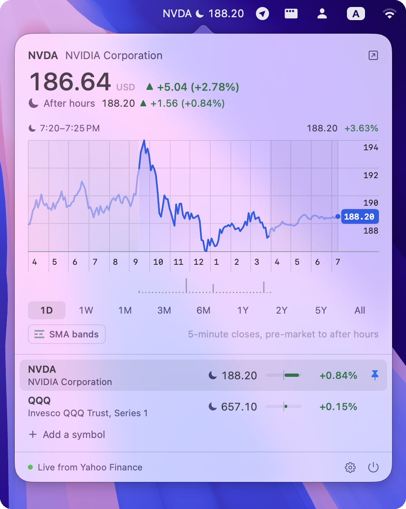
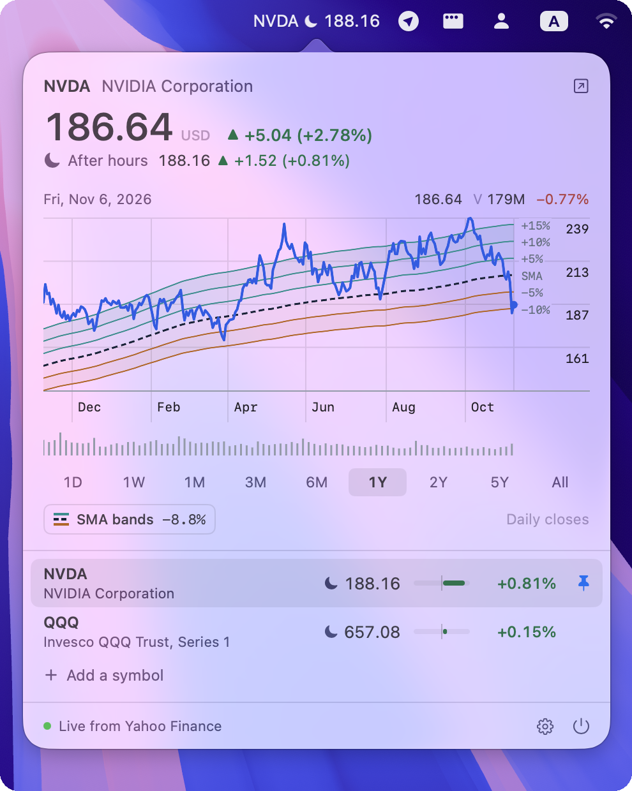

<p align="center"></p>

<h1 align="center">Portifo Bar</h1>

<p align="center">Live stock prices in the macOS menu bar.</p>

<p align="center">
  
  
</p>

A live, near real-time stream of stock prices in your menu bar, with simple
charts for keeping track of the stocks you follow. Prices stream from Yahoo
Finance's WebSocket.

## Install

Requires macOS 14 Sonoma or later, on Apple silicon or Intel. In Terminal:

```bash
curl -fsSL https://raw.githubusercontent.com/meysius/portifo-bar/main/install.sh | sh
```

This puts the latest release in `/Applications` and opens it. Run it again to
update.

The app isn't notarized by Apple, so macOS blocks it if it's downloaded in a
browser. The script downloads it with `curl` instead, which macOS doesn't
block, so you don't need to do anything else.

<details>
<summary>Installing by hand instead</summary>

Download `PortifoBar.zip` from the
[latest release](https://github.com/meysius/portifo-bar/releases/latest), unzip
it, and move **Portifo Bar** to Applications. macOS will refuse to open it,
saying it can't check it for malicious software. Remove the browser's
quarantine flag to fix this:

```bash
xattr -dr com.apple.quarantine "/Applications/Portifo Bar.app"
```

Or open it once, then go to System Settings → Privacy & Security and click
**Open Anyway**.
</details>
